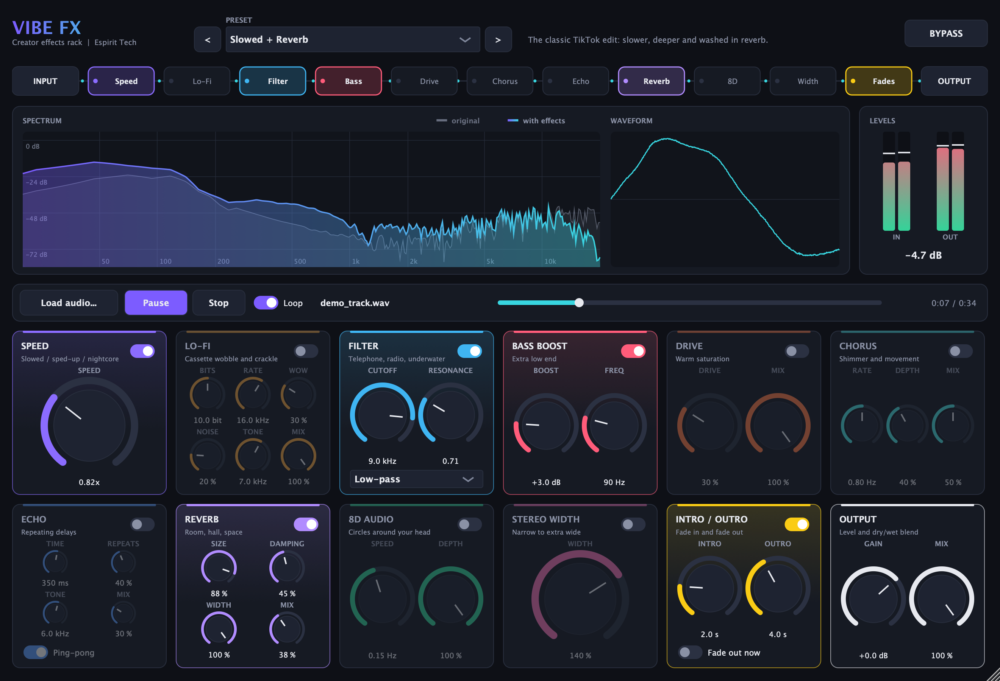

# JUCE 8 Audio Plugins — Gain PoC and Vibe FX

Two macOS audio plugins built with JUCE 8 and CMake (VST3 / AU / Standalone, universal binary):

- **Gain PoC**: a minimal gain plugin that proves the build, validation and DAW-loading pipeline.
- **[Vibe FX](#vibe-fx--creator-effects-rack)**: a multi-effect showcase with a live dashboard UI and
  15 one-click presets (Slowed + Reverb, Lo-Fi, Nightcore, 8D Audio and more).



---

## Gain PoC

A minimal gain plugin used as a proof of concept for the VST3 / AU / Standalone build,
validation and DAW-loading pipeline on macOS.

## Features
- Single **Gain** parameter, −60 dB (silence) to +12 dB, smoothed (20 ms) to avoid zipper noise
- Mono and stereo bus layouts
- Host automation and state save/restore via `AudioProcessorValueTreeState`
- Formats: **VST3**, **AU**, **Standalone**
- **Universal binary** (arm64 + x86_64), macOS 11.0+

## Requirements
- macOS with Xcode (tested with Xcode 26.6)
- CMake ≥ 3.22 (`brew install cmake`)

## Build
```bash
git clone --recurse-submodules https://github.com/omverma1810/JUCE.git
cd JUCE
cmake -B build -G Xcode
cmake --build build --config Release
```

Artefacts land in `build/GainPlugin_artefacts/Release/` and the AU/VST3 are copied to
`~/Library/Audio/Plug-Ins/Components` and `~/Library/Audio/Plug-Ins/VST3`.

## Validation
| Test | Result |
|---|---|
| `auval -strict -v aufx Gn01 Esp1` (arm64) | AU VALIDATION SUCCEEDED |
| `arch -x86_64 auval -strict -v aufx Gn01 Esp1` (Rosetta) | AU VALIDATION SUCCEEDED |
| pluginval 1.0.4, strictness 10 — VST3 | SUCCESS |
| pluginval 1.0.4, strictness 10 — AU | SUCCESS |

Full logs are in [`validation/`](validation/).

## DAW test — REAPER 7.82 (macOS arm64)
[`demo/reaper_gain_test.lua`](demo/reaper_gain_test.lua) is a ReaScript that loads the plugin
through REAPER's API, sets Gain to −6 dB, renders a −12 dBFS 1 kHz test tone
([`demo/sine_1k_-12dBFS.wav`](demo/sine_1k_-12dBFS.wav)) and logs the result.

| Format | Loaded by REAPER as | Gain | Output peak |
|---|---|---|---|
| VST3 | `VST3: Gain PoC (Espirit Tech)` | −6.0 dB | −18.00 dBFS |
| AU | `AU: Gain PoC (Espirit Tech)` | −6.0 dB | −18.00 dBFS |

Both formats attenuate the signal by exactly 6 dB. Rendered files and the log are in
[`demo/`](demo/).

To rerun it (uses a separate REAPER instance, so an open REAPER session is untouched):
```bash
/Applications/REAPER.app/Contents/MacOS/REAPER -newinst -nosplash -new "$PWD/demo/reaper_gain_test.lua"
```
The script writes to an absolute path, so edit `dir` at the top of the script if the repo lives elsewhere.

---

## Vibe FX — creator effects rack

A multi-effect plugin built around the effects popular in TikTok / YouTube song edits, with a
dashboard UI that shows what is happening to the sound in real time.

### Dashboard
- **Signal chain strip**: every module in processing order; lit when active, click to toggle,
  animated while audio flows
- **Spectrum analyser**: the original sound (grey) against the processed sound (colour)
- **Waveform** and **input / output level meters** with peak hold
- **Preset browser** with descriptions, and **Bypass** for instant before/after comparison
- **Built-in player** (standalone app): load or drag-and-drop any song, play, loop and seek

### Effects (in signal order)
| Module | What it does |
|---|---|
| Speed | Slowed / sped-up / nightcore (0.5x–1.5x). The standalone player changes real tempo and pitch; in a DAW it shifts pitch tape-style |
| Lo-Fi | Bit crushing, sample-rate reduction, wow & flutter, tape hiss and vinyl crackle |
| Filter | Low-pass, high-pass or band-pass (telephone, radio, underwater) |
| Bass Boost | Low shelf boost |
| Drive | Warm saturation |
| Chorus | Shimmer and movement |
| Echo | Delay with darkening repeats and ping-pong |
| Reverb | Room to huge hall |
| 8D Audio | Circles the sound around the listener |
| Stereo Width | Mono to extra wide |
| Intro / Outro | Fade-in when playback starts; fade-out on demand or at the end of the song |
| Output | Gain, dry/wet mix and a 0 dBFS safety limiter |

### Presets
Clean · Slowed + Reverb · Nightcore · Sped Up · Lo-Fi Chill · Vaporwave · 8D Audio · Telephone ·
Old Radio · Underwater · Echo Canyon · Concert Hall · Bass Boosted · Dreamy · Intro / Outro Fades

The presets are exposed as factory programs, so DAWs list them in their own preset menus.

### Demo material
- [`demo/demo_track.wav`](demo/demo_track.wav): a royalty-free 34 s loop, generated by
  [`demo/make_demo_track.py`](demo/make_demo_track.py)
- [`demo/vibefx_presets/`](demo/vibefx_presets/): the demo track rendered by REAPER through every
  preset (`.m4a`), the analysis log, and `VibeFX_demo.rpp`, a REAPER project ready for a live demo

**Quickest demo:** double-click [`demo/Start Vibe FX Demo.command`](demo/Start%20Vibe%20FX%20Demo.command).
It opens Vibe FX with the demo song loaded on "Slowed + Reverb" (building the app first if needed);
press Play.

Or from the terminal, with the demo track playing straight away:
```bash
open "build/VibeFX/VibeFX_artefacts/Release/Standalone/Vibe FX.app" --args --load "$PWD/demo/demo_track.wav" --preset "Slowed + Reverb" --play
```
Other standalone options: `--mute` (silence the speakers, keep the visuals) and
`--snapshot <file.png>` (save a screenshot of the window, then quit).

### Validation
| Test | Result |
|---|---|
| `auval -strict -v aufx Vbfx Esp1` (arm64 and x86_64) | AU VALIDATION SUCCEEDED |
| pluginval 1.0.4, strictness 10 — VST3 and AU | Re-run pending on the latest build |
| REAPER 7.82: VST3 loads with 50 parameters and all 15 presets, each rendered | Passed |

Logs are in [`validation/vibefx/`](validation/vibefx/) and
[`demo/vibefx_presets/reaper_vibefx_results.txt`](demo/vibefx_presets/reaper_vibefx_results.txt).

---

## Plugin identifiers
| Field | Gain PoC | Vibe FX |
|---|---|---|
| Manufacturer code | `Esp1` | `Esp1` |
| Plugin code | `Gn01` | `Vbfx` |
| Bundle ID | `com.espirittech.gainplugin` | `com.espirittech.vibefx` |

## Not yet covered
- Logic Pro / GarageBand testing of the AU
- Developer ID code signing and notarization
- AAX (requires Avid developer account, AAX SDK and PACE signing)
